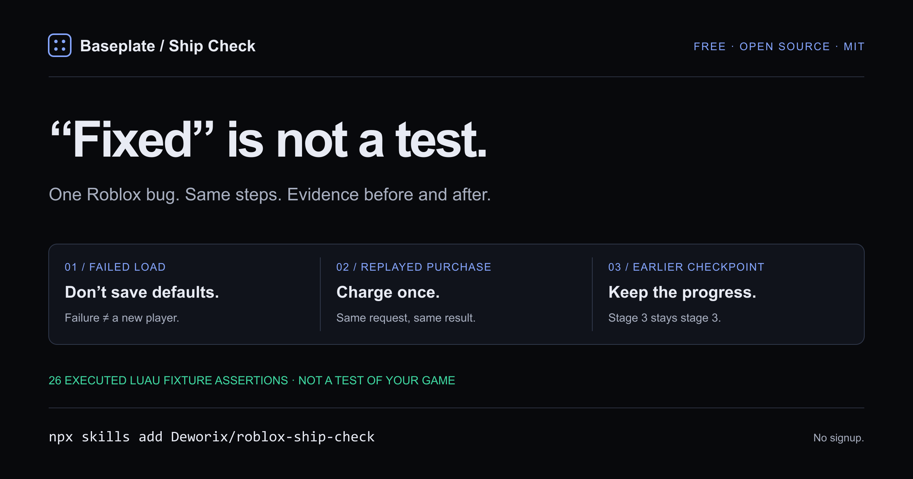

# Roblox Ship Check



**Your AI says “fixed.” Ask it to run the same test.**

A free, open Agent Skill from [Baseplate](https://baseplatedev.com/?utm_source=github&utm_medium=resource&utm_campaign=ship_check_20261029) for one reproducible Roblox bug: reproduce it, review a focused change, rerun the same check, and keep the evidence.

This is a small testing workflow and an in-memory Luau lab. It is **not another coding agent, MCP server, production save system or security certification**. No Baseplate installation, signup, API key or payment is required. Your existing AI tool's usage limits still apply.

## Use it with your agent

Review [the skill](skills/roblox-ship-check/SKILL.md), then install it with the open [skills CLI](https://github.com/vercel-labs/skills):

```sh
npx skills add Deworix/roblox-ship-check --skill roblox-ship-check
```

Choose your existing agent in the installer. The pack uses the Agent Skills format; the installer supports clients including Claude Code, Codex and Cursor. Client discovery was checked separately from running an authenticated AI session; see [validation](VALIDATION.md).

The pack has no analytics or network code. The third-party skills installer downloads from GitHub and has its own anonymous install telemetry; it supports `DO_NOT_TRACK=1` if you prefer to opt out.

Or copy `skills/roblox-ship-check` into the skills location supported by your agent. Do not change your existing MCP configuration just to use this pack.

Then ask:

> Use roblox-ship-check on this bug: after buying one sword, a repeated request charges the player twice. First reproduce the problem on a local copy. Keep the test unchanged, review the smallest fix, then run it again. If Studio is unavailable, show what you can establish and what you could not run.

The skill uses the tools already available to your agent. It does not connect to Studio by itself. No access means a clear blocker, not an invented PASS.

## Try the failure lab without AI

Open [failure-lab.luau](skills/roblox-ship-check/assets/failure-lab.luau). It is self-contained Luau using tables, functions and assertions only. No services, DataStores, HTTP requests or place edits.

- In a blank Studio place, paste its contents into the Command Bar and run it.
- Or, with [Lune](https://lune-org.github.io/docs/getting-started/1-installation/) already installed, run:

```sh
lune run skills/roblox-ship-check/assets/failure-lab.luau
```

| Case | The broken assumption | The focused check |
|---|---|---|
| Failed load | Treating a read failure as a new player | No save from an unverified load |
| Duplicate purchase | A repeated request must be a new purchase | Same request charges and grants once |
| Checkpoint rollback | Every touched checkpoint replaces progress | Earlier/equal stages do not move progress back |

Each case first detects the intentionally broken behavior, then checks a corrected **in-memory example**. A passing lab proves those fixture assertions ran. It does not test your game, real DataStore durability, concurrent servers, UI or gameplay physics. Do not install these simplified examples as production systems.

## Keep an inspectable result

The agent can copy [report.template.json](skills/roblox-ship-check/assets/report.template.json), fill it with actual observations, then run:

```sh
node skills/roblox-ship-check/scripts/check-report.mjs path/to/report.json
```

The checker rejects a reported PASS without an executed failing baseline, an executed passing rerun, revision identifiers and evidence references. It checks consistency; **it cannot authenticate an agent's claims or replace the test**. It only reads the chosen local JSON file. It does not upload or execute anything.

## Why Baseplate publishes this

The manual habit should be useful even if you never buy our app. [Baseplate](https://baseplatedev.com/?utm_source=github&utm_medium=resource&utm_campaign=ship_check_20261029) brings your supported AI CLI, local game files and Studio tools into one desktop workspace. Its free local Map and Verify reads do not need an AI account or Open Cloud key. Runtime tests need an actual Studio connection.

Already stuck on one task? [Ask for free written help](https://baseplatedev.com/founding-10.html?utm_source=github&utm_medium=resource&utm_campaign=ship_check_20261029). No call, purchase, testimonial or source upload required.

## Contribute a reproducible case

Open an issue with expected behavior, actual behavior and the smallest **public, owned** reproduction. Do not submit private projects, credentials, player data or suspected vulnerabilities in someone else's live game. A useful recipe needs the same observable test before and after; a generic list of prompts is not enough.

Original pack and examples: MIT. Not affiliated with Roblox, Anthropic, OpenAI or Cursor. No endorsement from an index or directory is implied.
