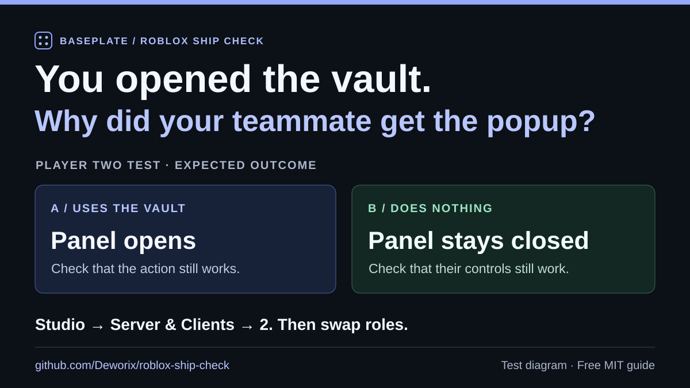

# Pick one boundary to test

These are original test recipes, not production save/shop systems. Use a fake boundary or an isolated project you are authorized to change. Do not execute adversarial requests in someone else's live game.

## Failed profile load

Observable invariant: a failed read must not become a default profile that is later saved over an existing player's progress.

First make a fake reader fail. Check that the session is not considered loaded and that a subsequent departure/save request writes nothing. Then check the distinct case of a successful read returning nil: that can represent an absent key. A successful existing-profile read should retain its data. Also inspect what happens when the eventual write fails; a catch alone is not a retry/durability design.

The failure lab covers the first three branches only. Real persistence additionally needs the project's session ownership, concurrency, shutdown, retries, schema and request-budget strategy. Roblox documents that Studio API access can reach the same data as the live game: [Data stores](https://create.roblox.com/docs/cloud-services/data-stores).

## Duplicate purchase

Observable invariant: replaying the same request within the chosen scope does not charge or grant twice.

Use a server-owned catalog in a fake profile. Start from a known balance, send the same request ID twice and inspect both the balance and inventory. Then try the same ID with a different item: it must not silently authorize that other purchase. A different legitimate request should still work if the game's purchase rules allow it.

The lab handles sequential in-memory calls. It does not prove correctness under yields, multiple servers, process crashes, persistent receipts, developer-product callbacks or malicious request spam. Runtime remotes also need server-side type, range, context, permission and rate checks: [Client/server boundary](https://create.roblox.com/docs/scripting/security/client-server-boundary).

## Progression rollback

Observable invariant: reaching stage 3, touching stage 1 and respawning keeps the player at the intended stage 3.

Start with a pure progression transition, including equal stages and invalid input. Then run the real touch/respawn sequence in the copied Studio game, observe the character's actual location/state and compare against an explicit tolerance. Do not substitute an assignment to the stage value for the player touching a checkpoint.

The lab checks the numeric transition only. It does not exercise touch events, respawn positions, persistence or multiplayer authority. A server must also establish that reaching that stage is legitimate; the increasing-number guard alone is not an anti-exploit system.

## Player Two Test

**You opened the vault. Why did your teammate get the popup?** Pick one interaction whose UI should belong only to the player who uses it. A vault panel, personal quest prompt or shop menu works. Write down the rule first. A public announcement or a door everyone should see needs a different check.

On a local copy, choose **Server & Clients → 2** and start the session. Label the windows A and B. Give both players access for the first two runs. Place the observer where they can see whether their controls or UI change. Clear both panels before each run, or restart with the same setup. [Roblox Studio testing modes](https://create.roblox.com/docs/studio/testing-modes#multi-client-simulation)

| Do this | A should see | B should see |
| --- | --- | --- |
| A uses the interaction while B waits | Panel opens | Panel stays closed and controls still work |
| B uses the interaction while A waits | Panel stays closed and controls still work | Panel opens |
| A tries after losing the required access, if your game has this rule | Panel stays closed | Panel stays closed |

Record what actually happened on **both** screens. If both panels open, trace the code that opens the UI. If it comes from the server, check whether a private message is sent with `FireAllClients()` and whether `FireClient(player, …)` is appropriate. Keep eligibility on the server and derive the recipient from the interaction's player. A change in who receives a popup does not itself fix authorization. [Roblox remote events](https://create.roblox.com/docs/scripting/events/remote) · [Client/server boundary](https://create.roblox.com/docs/scripting/security/client-server-boundary)

Paste into your agent if you want help:

> Trace how this private panel opens. Keep my two-client test steps unchanged. Show where the server checks eligibility and how the recipient is chosen. Propose the smallest change, then have me compare both clients in Studio. If either screen wasn't observed, leave that result unverified.

Repeat with the same player roles, positions and access. Save one before/after pair showing both screens. The check passes when the eligible actor sees their panel, the observer's UI and controls are unchanged, and a denied interaction opens no panel if that rule applies. This is a manual Studio check and is separate from the in-memory lab.

Stuck tracing the panel? [Send Baseplate the interaction and what each player saw](https://baseplatedev.com/founding-10.html?utm_source=github&utm_medium=resource&utm_campaign=player_two_test_20261104) for free written help. A short description is enough.

## Late settings reply

Pick one setting a player can change as soon as the menu opens. Suppose the saved music volume is 30% and the player chooses 75%. Check what the player sees and hears while their saved settings are still loading.

1. On a local copy, make the settings response wait a few seconds and return a fixed test profile with music at 30%. Start with a fake read and record the save requests locally. Roblox Studio's [Network Simulator](https://create.roblox.com/docs/studio/network-simulator) can add playtest latency for a separate realistic check. A controlled delay at the settings response makes this order repeatable.
2. Open the menu before the reply arrives. If it is editable, choose 75%. Wait for the reply and any save debounce. Record the displayed volume, applied volume and requested save value.
3. Repeat with the reply arriving first, then choose 75%. Compare the same three observations. Add a second saved preference you never touch and check that it retains its saved value.

For an immediately editable menu, the late reply should preserve the explicit change to 75% and load the other preferences. If editing must wait, show a loading state and enable the controls only when the data is ready. The edit after loading should still work. Also try a failed load and check that the UI gives a way to recover without saving a default snapshot over existing settings.

This test can show which value was displayed, applied and sent to the server. To check persistence, run a separate rejoin test with isolated test data. Record that result separately from the save request.

If the menu still jumps back, [send the sequence to Baseplate for free written help](https://baseplatedev.com/founding-10.html?utm_source=github&utm_medium=resource&utm_campaign=late_settings_reply_20261113#apply).

## Quick rejoin after a reward

Pick one reward that is earned before the client finishes showing it, such as offline income with an intro animation. Write down when it becomes irrevocably earned. If the player must actively claim it, start the test after the server accepts that claim. Check the authoritative balance and the saved state that controls whether the same reward can be issued again.

1. Seed a fake profile with balance 100 and a pending reward of 15. On a local copy, let the server reach the earned step, wait for the notification and rejoin. The balance should be 115.
2. Reset to the identical profile. Leave after the earned step and before the animation or notification finishes. Rejoin after the departure write has settled. The balance should still be 115, and a second rejoin should leave it at 115. Use a fixed clock or disable new accrual so the result measures only the original reward.
3. Record the server balance, the persisted balance and the reward marker. A saved marker with a balance of 100 points to a lost reward. A balance of 130 points to a duplicate. Repeat the same steps after the fix, including the normal join as a control.

Use a simulated store first. To verify persistence in Roblox, use a separate authorized test experience and test-only player data. Studio with API access enabled can reach the same DataStores as the live game if it is part of that experience. A clean rejoin test does not cover a failed write or overlapping servers. [Roblox DataStore documentation](https://create.roblox.com/docs/cloud-services/data-stores#enable-studio-access)

[Send Baseplate the two observed balances for free written help](https://baseplatedev.com/founding-10.html?utm_source=github&utm_medium=resource&utm_campaign=quick_reward_rejoin_20261114#apply). A short description is enough.
